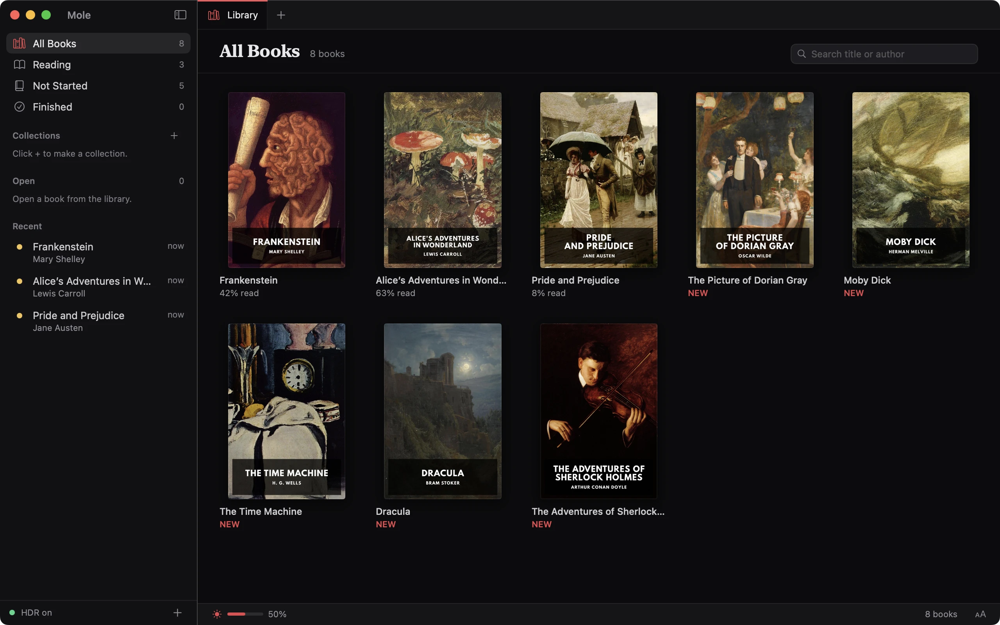

<p align="center">
  
</p>

<h1 align="center">Mole</h1>

<p align="center"><b>The first e-reader with HDR text: letters brighter than white on a black page.</b></p>

<p align="center">
  <a href="https://github.com/pedrohavay/mole/releases/latest"></a>
  <a href="https://github.com/pedrohavay/mole/actions/workflows/ci.yml"></a>
  <a href="LICENSE"></a>
  
  
  <a href="https://github.com/pedrohavay/mole/releases/latest/download/Mole.dmg"></a>
</p>

<p align="center">
  <a href="https://github.com/pedrohavay/mole/releases/latest/download/Mole.dmg"></a>
</p>

<p align="center">
  
</p>

Mole is a book reader for the Mac. It keeps the page black and lights only
the letters. On an HDR screen, the letters can shine brighter than white,
while every other pixel stays dark. The name comes from the animal, which
lives in the dark and needs very little light to find its way.

> [!NOTE]
> Mole is in early development, so expect rough edges. If something breaks,
> please [open an issue](https://github.com/pedrohavay/mole/issues).

## Features

### Light

- Text that glows brighter than white, as far as your screen allows.
- Four text colors: white, warm, amber and red.
- A brightness level and three stroke weights.
- Books open at full brightness, so the text does not fade in.

### Books

- EPUB, MOBI, PRC, FB2, plain text and PDF books.
- PDFs keep their printed pages. Mole fits them to the window, one or two
  side by side, and you can zoom in and scroll. Their text glows like any
  book's.
- Pictures in their own colors, never brighter than white. At night,
  diagrams are inverted so their lines glow. Click a picture to zoom in.
- The book's own text colors if you want them, so a red heading glows red.
- The book's fonts or one of the Mac's, with your choice of line spacing,
  margins and alignment.
- A clear message when a book is locked with DRM or a PDF needs a
  password.

### Reading

- Search, notes, bookmarks and highlights in five colors. You can copy all
  of a book's highlights as Markdown.
- Your place is tied to the text. It stays put when you change the font,
  the text size or the window.
- The dictionary for any word, and translation of a selection on macOS 14.4
  and later.
- The reading time left in the chapter and the book, based on your own pace.
- Read aloud with the system voices. The sentence being read is lit, and
  the pages turn on their own.
- VoiceOver support. Mole also follows Reduce Motion and Increase Contrast.

### Library

- Covers, shelves for books you are reading, have not started or have
  finished, and search by title or author.
- Collections you make by hand or from your folders. A synced folder adds
  new books as they show up.
- Tabs that come back when you open Mole again.
- A keyboard shortcut for every reading control.
- English and Brazilian Portuguese.
- Updates through Sparkle in release builds, if you allow them.

## Requirements

- macOS 14 Sonoma or later, on a Mac with Apple silicon.
- An HDR screen for the full effect, such as the Liquid Retina XDR screen
  of a MacBook Pro or the Pro Display XDR.

> [!IMPORTANT]
> On a screen without HDR, Mole still works, but the text stops at normal
> white.

On an OLED screen, the space around the letters is fully off. A MacBook Pro
uses mini-LED, which lights the screen in zones, so you may see a faint glow
around lines of text.

## Install

1. Download [Mole.dmg](https://github.com/pedrohavay/mole/releases/latest/download/Mole.dmg)
   from the latest release.
2. Open it and drag Mole to the Applications folder.
3. Open Mole from Applications.

Mole is signed with a Developer ID and notarized by Apple. The first time
you open it, macOS asks you to confirm that you want to open an app from
the internet. When a new version comes out, Mole offers it through Mole >
Check for Updates.

### Build from source

You need Xcode 15.4 or later and Go 1.26 or later.

```bash
git clone https://github.com/pedrohavay/mole.git
```

```bash
cd mole && make run
```

`make run` builds `build/Mole.app` and opens it. The first build also
downloads MuPDF (about 65 MB) and compiles it, which takes a minute or two.
[CONTRIBUTING.md](CONTRIBUTING.md) covers the rest of the build.

> [!WARNING]
> A build from source has an ad hoc signature. It runs on the Mac that
> built it, but Gatekeeper blocks a copy moved to another Mac.

## Usage

Add books with File > Add Books (⌘O), by dropping files on the library, or
with Open With > Mole in Finder. Mole keeps its own copy of each book, so
you can move or delete the original file. Double-click a cover to open the
book. The library and the copies live in `~/Library/Application Support/Mole`.

Drop a folder to add every book in it. Mole asks whether each folder should
become a collection and whether to keep it in sync. A synced folder is
checked while Mole runs and again at launch. When a file leaves the folder,
its book stays in the library with a "Not in folder" mark until you remove
it.

To turn the page, click the right side, press →, or swipe left. Click the
left third or press ← to go back. The sun button in the status bar sets the
brightness and the text color. The Aa button at the other end sets the
size, the font, the spacing and how pictures look.

In a PDF, + and − zoom in and out, and the status bar shows the zoom. Click
it to fit the page or the width. Fonts, spacing and margins do not apply to
PDFs, and search looks within each page, so it misses a phrase split across
two pages.

Drag across the text to select it. The bar above the selection can
highlight it, add a note, copy it or search for it. The side panel (⌥⌘C)
holds the contents, bookmarks, notes and search.

The speaker button, or Book > Read Aloud (⇧⌘R), reads from the top of the
screen or from the selection. Press it again to pause. Settings > Reading
picks the voice and the speed.

> [!TIP]
> Help > Keyboard Shortcuts lists every shortcut in the app.

<details>
<summary>Keyboard shortcuts</summary>

While reading:

| Keys | Action |
|------|--------|
| → or Space or Page Down | Next page, or the rest of a zoomed PDF page |
| ← or ⇧Space or Page Up | Previous page, or back up a zoomed PDF page |
| Home, End | Beginning or end of the book |
| ↑, ↓ | Brighter or dimmer text |
| +, − | Bigger or smaller text, or zoom in a PDF |
| E | Turn HDR on or off |
| C | Next text color |
| T or ⌥⌘C | Show or hide the side panel |
| F or ⌃⌘F | Full screen |
| Esc | Close a picture, clear the selection, stop reading aloud, or leave full screen |
| ⌘+, ⌘−, ⌘0 | Zoom an open picture in, out or to fit |
| ⌃⌘D or force click | Look up the selection or the word in the dictionary |

Anywhere in the window:

| Keys | Action |
|------|--------|
| ⌘O | Add books |
| ⌘N | New collection |
| ⌘F, ⌘G, ⇧⌘G | Find in the book, next and previous result |
| ⌘D | Bookmark the page |
| ⇧⌘H | Highlight the selection |
| ⌘C | Copy the selection |
| ⌘W | Close the book |
| ⌘1, ⌘2 to ⌘9 | Library, then the open books in tab order |
| ⌃⇥, ⌃⇧⇥ | Next or previous tab |
| ⌃⌘S | Show or hide the sidebar |
| ⌥⌘↑, ⌥⌘↓ | Brighter or dimmer text |
| ⇧⌘R | Read aloud, pause or resume |
| ⌘. | Stop reading aloud |
| ⌘, | Settings |

</details>

## How it works

Mole has two parts in one app. A Go core uses [MuPDF](https://mupdf.com) to
lay out each book. It draws the visible page as a map of how much ink each
pixel has, and it keeps the library in SQLite. The SwiftUI app turns that
map into light with a Metal shader. Pixels with no ink stay at zero. Pixels
inside a letter can go above the value of white, up to what the screen can
show at that moment. macOS calls this Extended Dynamic Range (EDR).

[docs/ARCHITECTURE.md](docs/ARCHITECTURE.md) has the details.

## Contributing

Bug reports and pull requests are welcome.
[CONTRIBUTING.md](CONTRIBUTING.md) explains how to set up the build, run
the tests, add a language and send a change. It also lists the things that
tie Mole to the Mac.

## License

Copyright (C) 2026 Pedro Havay

Mole is free software under the GNU Affero General Public License, version 3
or later. See [LICENSE](LICENSE) for the full text.

Mole includes MuPDF, which Artifex shares under the same license, plus the
libraries and fonts that come with it, a few Go modules and Sparkle. Their
licenses are in [THIRD_PARTY_NOTICES](THIRD_PARTY_NOTICES). The app also
shows them in Help > Third-Party Notices.

## Acknowledgements

[MuPDF](https://mupdf.com) lays out and draws the books.
[modernc.org/sqlite](https://gitlab.com/cznic/sqlite) gives the core SQLite
with no extra C library, and [Sparkle](https://sparkle-project.org) keeps
the app up to date. This software is based in part on the work of the
Independent JPEG Group.

The books in the screenshot are public domain editions from
[Standard Ebooks](https://standardebooks.org).
